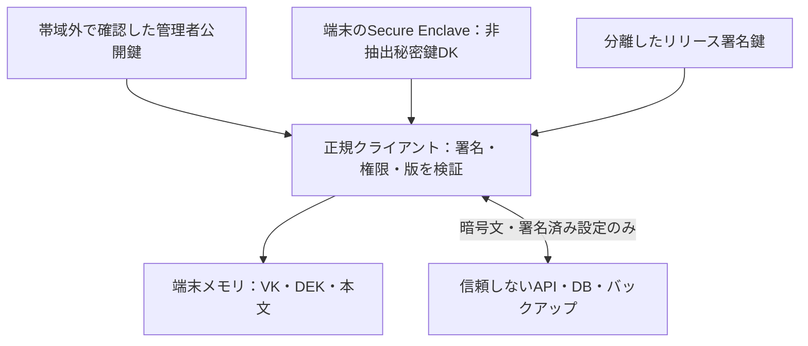

# 顧客情報保護サービス・PoC 要件定義書

版：1.2（第3ラウンド・着手条件整理）／作成日：2026年10月17日  
原案：プロジェクト責任者／技術協議：ChatGPT・Claude／取りまとめ・採否判断：ChatGPT  
状態：企画要件と実機検証G0の作業範囲を整理済み。G1の詳細仕様確定、PoC実装、実機試験、監査、顧客承認は未実施です。

### 第3ラウンド時点の判断

| 対象 | 判断 | 根拠・次の条件 |
| --- | --- | --- |
| 基本構想 | 小規模な暗号保管庫に絞って継続 | 指定本文を端末側で処理し、サーバーへ復号能力を渡さない |
| 事業の入口 | 適合性調査の原稿・範囲を整理済み | 価格・受注条件は提案値。完成製品や監査済みと表示しない |
| G0 | 実機APIの限定検証へ渡せる | 実機・開発環境を確認後、第17節の作業票で開始 |
| PoC-A/B全体 | 詳細仕様の確定前 | G0実測とG1仕様が揃ってから実装方式・工数を確定 |
| 本番利用 | 未着手 | 独立レビュー・運用・配布・回復の設計が必要 |
| 検証実績 | 受入試験0/23項目 | AIとの文書協議を試験合格に換算しない |

## 1. 採用する現実的な落とし所

最初に作るものは、企業の顧客情報全体を置き換える基幹システムではなく、**特定業務の機微情報を、登録された端末で暗号化・復号する小規模な保管庫**とします。既存システムにはランダムな参照IDだけを残し、機微情報を保管庫へ分離する方式を第一候補とします。参照IDも他情報との結合で個人に結び付く可能性があるため、匿名化済みとは扱いません。

販売は適合性調査から始め、調査後の個別設計、PoC、実装を別契約に分けます。調査だけで「この業務には適さない」と判定することも、正常な納品結果とします。

| 対象 | 今回の方針 |
| --- | --- |
| 守る内容 | 指定した氏名・連絡先・自由記述等の顧客情報本文 |
| 最初の業務 | 担当者が登録・閲覧する保管業務。自動処理を必要としないもの |
| 暗号処理 | 信頼するネイティブクライアント内で実行 |
| サーバー | 暗号文・暗号化済み鍵・署名済み設定の保管と中継 |
| 鍵の鍵 | 保管庫鍵VK（KEKに相当）でレコード暗号鍵DEKを保護 |
| 端末制限 | ハードウェア保護された端末秘密鍵DKがなければVKを取得できない構成 |
| 初期OS | Apple Silicon Mac。Windowsは別の実機検証を経て対応判断 |
| 販売可能な入口 | 現状調査・適合性評価。完成製品の販売とは表示しない |
| 初期PoC | A：単一端末で中核検証、B：別実機で登録・回復・失効範囲を検証 |

## 2. 目的・達成条件・境界

### 2.1 目的

DB、バックアップ、アプリサーバーの管理者権限とその認証情報が流出しても、それらだけでは保護対象本文を復号できない構造を検証します。サーバーの不正応答を正規端末に送った場合も、鍵・平文の送信や攻撃者端末への鍵配布を誘発できないことを試験します。

「侵入されない」「盗まれても被害がない」という保証にはしません。本文の機密性、改ざん検知、可用性、状態の新しさは別々に評価します。

### 2.2 信頼するもの

- 正規端末のOS・ハードウェア・本人確認と、検証済みクライアント。
- 初回に帯域外で確認して固定した保管庫の管理者公開鍵。
- データサーバーと権限・保管経路を分離したリリース署名鍵と配布手順。
- 端末追加・管理権限変更時に操作者が行う公開鍵指紋の照合。

### 2.3 信頼しないもの

- DB、サーバーのファイル・環境変数・ログ・バックアップ・管理者。
- サーバーが返す端末一覧、公開鍵、ロール、暗号文、エラー、更新案内。
- サーバー上の認証結果だけを根拠とする復号許可。

### 2.4 対象外とするもの

正規端末の乗っ取り・OS管理・EDR等の端末対策は端末管理側の範囲です。サーバー侵害に伴う悪性クライアント配信や、細工された応答を介した鍵取得は本件の検証対象に含めます。

正規利用者による撮影・転記・既に取得した平文の持出し、サービス停止・データ破壊の完全防止、過去に漏れた平文の回収、法令適合の認証、暗号化だけを理由とする漏えい報告要否の判断は本サービスの保証に含めません。

## 3. 顧客システムの適合性調査

従業員数だけで価格・可否を決めません。企業全体が大きくても、対象業務が独立していれば小さく検証できます。

| 調査軸 | 必須確認事項 | 設計・工数への影響 |
| --- | --- | --- |
| 業務 | 利用目的、登録・閲覧・更新・削除の流れ、責任者 | 保護対象と平文が必要な場所 |
| データ | 項目、件数、1件容量、機微度、保持期間 | 暗号単位、移行、性能 |
| システム | アプリ数、DB数、スキーマ、運用主体、改修権限 | 調査範囲と改修可否 |
| 端末 | OS・版・機種・台数・共有利用・TPM/SE・管理方法 | 鍵API、配布、本人確認 |
| 連携 | API、CSV、メール、帳票、CRM、ETL、BI、AI利用 | 平文流出経路と代替案 |
| 検索・集計 | 必要項目、範囲、処理場所、応答時間 | 保護目標との衝突 |
| 権限 | 組織、担当者、保管庫単位、異動・退職 | 鍵配布と失効の複雑さ |
| 運用 | 登録承認、紛失、回復、更新、障害、監査 | 鍵喪失時の対応可否 |
| 基盤 | AWS/Azure/GCP/オンプレ、ネットワーク、バックアップ | API配置、復旧手順 |
| 非機能 | RTO/RPO、同時利用、可用性、証跡、要求基準 | 本番設計と費用 |

### 3.1 判定区分

| 判定 | 条件・例 | 次の扱い |
| --- | --- | --- |
| 適合候補 | 端末側で処理できる独立した保管・閲覧業務 | 個別設計またはPoCへ |
| 条件付き | 一部連携の停止・変更、端末アプリ導入、保護項目分離が必要 | 条件と追加費用を提示 |
| 目標と不適合 | 保護本文を同じ侵害対象サーバーで常時平文処理することが必須 | 当該目標では導入不可と報告 |
| 初期商品対象外 | 大規模、多OS、ブラウザー必須、複雑な権限、24時間対応 | 原理的不可とはせず個別案件化 |
| 情報不足 | 構成・処理経路・改修権限を確認できない | 未確認事項と再評価条件を納品 |

DB全体の透過暗号化、ディスク暗号化、アプリに復号権限があるKMSを導入するだけでは、今回のサーバー侵害目標を満たしたとは判定しません。

## 4. 初期PoCの対象範囲

### 4.1 検証環境

| 項目 | PoC-A | PoC-B |
| --- | --- | --- |
| 組織・保管庫 | 単一組織・1保管庫 | 同左 |
| 端末 | SE搭載Apple Silicon Mac 1台 | 独立したSEを持つMac 2台。最大2台の逐次運用 |
| 利用権限 | 全レコード同一権限 | 全レコード同一権限。端末管理の権限は別管理 |
| データ | 架空の顧客データ1,000件、1件最大16KiB | 同左 |
| 処理 | 作成・ID指定閲覧・更新・論理削除 | 加えて端末追加、管理者交代、再登録、epoch更新 |
| クライアント候補 | SwiftUI＋CryptoKit＋Security.framework | 同左 |
| サーバー候補 | 小さなREST API＋SQLite、独立したLinux検証環境 | 同左 |
| 同時編集 | 単一書込者。競合時は拒否し再読込 | 同左。高度な同期は除外 |
| 配布 | 手動導入。署名・指紋照合を検証 | 同左 |

件数・容量はPoCの試験条件であり、製品上限や実測済み性能ではありません。PoC-A単独では複数物理端末の保護・回復を実証済みと扱いません。VMや同じMacの別ユーザーはPoC-Bの代用にしません。

### 4.2 初期に作らないもの

汎用CRM、細粒度の担当者別権限、全文検索・検索可能暗号、外部API/CSVの取込、BI/AI連携、平文エクスポート、モバイル版、ブラウザー版、自動更新、複雑な同期、紙の回復鍵、Shamir分散、独立したオンライン鮮度サービスは初期PoCから除外します。

ハードウェア鍵のリモート証明は後続課題です。PoCでは管理下の実機と検証済みアプリで鍵生成を確認します。公開鍵や署名だけから、遠隔端末の秘密鍵が必ずSE/TPM内にあると証明できるとは扱いません。

## 5. アーキテクチャと鍵管理

### 5.1 構成

### 5.2 鍵の役割

| 鍵 | 生成・保護 | 用途 | サーバー保管 |
| --- | --- | --- | --- |
| DK | 各実機のSEで生成する非抽出P-256秘密鍵 | 自端末向けに封緘されたVKの復元 | 公開鍵のみ |
| VK（KEK） | 正規クライアントで暗号学的乱数生成、256bit、epochごと | DEKの保護 | 端末ごとの封緘済みVKのみ |
| DEK | レコードの作成・更新ごとに新規256bit | 本文をAES-256-GCMで暗号化 | VKで保護した値のみ |
| 管理者署名鍵 | 管理者端末のSEでDKと分離して生成 | 端末一覧・管理権限・epoch設定の署名 | 公開鍵と署名のみ |
| 書込署名鍵 | 各端末のSEでDKと分離して生成 | 書込者と暗号化レコードの結び付け | 公開鍵と署名のみ |
| リリース署名鍵 | データサーバー・その認証情報から独立して管理 | クライアント配布物の真正性 | 検証情報のみ |

VKとDEKは復号処理中にクライアントの通常メモリへ現れます。「すべての鍵がSEから出ない」とは表示しません。非抽出なのは端末秘密鍵等です。鍵は役割別に分離し、DKをそのまま認証署名用に流用しません。

### 5.3 暗号プロファイルと着手前スパイク

- 本文：CryptoKitのAES-256-GCM、96bit nonce、128bit tag。更新ごとにDEKを作り直します。
- DEK封緘：VKから用途・保管庫・epoch・record_id・versionを束縛してHKDF-SHA256で派生した鍵を使用し、AES-GCMで保護する候補とします。固定長/長さ付き符号化と用途ラベルを設計書で確定し、96bitの新しいランダムnonceを毎回生成し、再利用を許しません。派生鍵が一意になる想定だけを根拠に固定nonceを使いません。
- VK封緘：MacではSecurity.frameworkの既成ECIES APIを第一候補に、SE鍵で実行可能か実機確認します。正確なアルゴリズム識別子、鍵属性、本人確認条件、出力形式はスパイク結果で固定します。
- HPKE RFC 9180は将来の共通形式候補です。非抽出SE鍵を扱える実装の確認前に採用確定しません。AppleのECIES出力をHPKE形式とは呼びません。
- SE非対応、API失敗、鍵アクセス拒否時は処理を止めます。ソフトウェア鍵への自動切替は禁止します。
- 独自暗号アルゴリズムやAIが書き起こしたECDH/ECIES/HPKE実装は使いません。既存APIの組合せについても第三者レビュー対象にします。

同じVKで繰り返すDEK封緘にも安全なnonce設計が必要です。レコード別DEKの導入だけで、すべてのGCM nonce問題が解消するとは扱いません。

### 5.4 保存形式・署名

暗号化レコードのヘッダーは、少なくともformat_version、vault_id、record_id、version、epoch、schema_version、writer_id、prev_record_hash、policy_version、policy_hashを含みます。本文用nonce/tag、封緘DEK用nonce/tag、本文暗号文、封緘DEK、書込署名を保存します。

認証対象の符号化方式は実装前に一意に固定します。区切り文字連結だけにはせず、固定長または長さ付きのバイナリ符号化等を採用し、共通テストベクトルを用意します。署名はヘッダーと暗号文・封緘DEK・nonce/tag全体に及びます。署名対象とAEADのAADに曖昧なJSON文字列化を使いません。

端末一覧はvault_id、policy_version、epoch、許可された各公開鍵と用途、管理者権限、直前設定のハッシュを含む署名済み設定とします。署名者の権限は直前に承認された設定から検証し、当該設定自身の自己申告だけで許可しません。VK封緘物は宛先公開鍵・vault_id・epoch・enc_alg・blob全体を管理者署名で束縛します。

加えて、VKから用途を分離して導出する確認値vk_commitを署名済み設定へ記録し、VK復元後に照合します。確認値の一致だけを承認根拠にはしません。署名・文脈束縛・確認値のいずれかが不正なら書込を停止します。攻撃者が自分の知るVKを正しく封緘して送り付ける「鍵注入」を、明示的な検証対象にします。

書込者はレコードが参照するpolicy_version・policy_hashの正規設定で検証します。policy_versionは設定の版、epochはVKの世代であり、同義ではありません。初期PoCでは端末の追加・除外・管理者交代を含む役割変更のたびに、policy_versionとepochを同じ署名済み設定で更新します。通常の新規書込はローカルに固定した現在の設定とepochだけを使用し、未知の設定では停止します。

旧epochの署名が正しいだけでは、そのレコードが端末除外前から存在した証明にはなりません。初期PoCは現行レコードの閲覧に限定し、epoch移行時に承認者が観測・検証済みのrecord_id、version、暗号化レコード全体のSHA-256ハッシュ、tombstone状態を一覧化した署名付きチェックポイントを作成します。移行先の設定はそのハッシュを束縛し、直前設定で権限を持つ管理者が移行設定と併せて承認します。本文の複製やMerkle木は不要です。

新端末にも帯域外で確認した設定に結び付くチェックポイントを渡します。旧epochのレコードを通常画面で受理するには、当該設定による書込署名に加え、そのrecord_id/version/hashが移行時の承認済み一覧と一致する必要があります。現在epochで更新されたレコードを古いチェックポイントの値へ戻すことは許可せず、ローカル既観測版・現在設定への束縛を併せて検証します。任意の旧版を自由に遡る履歴閲覧機能は初期対象外です。

チェックポイントは移行時に観測した状態だけを表します。事前にサーバーが隠した未観測書込は回復・完全性の保証対象にできません。既に観測済みのレコードをサーバーが隠した場合は、ローカル記録から欠落を検知し、移行を止めます。チェックポイントの署名だけで一覧の完全性や全端末の最新性を証明したとは扱いません。

共有VKを知る端末は共通鍵の暗号文を作れます。AEADを「特定の書込者の証明」と誤認しないため、書込署名を別途確認します。

### 5.5 初回導入・信頼の起点

1. データサーバーの表示だけに依存しない経路でクライアントの署名者・配布物を確認します。
2. 管理者端末AがDK・管理者署名鍵・書込署名鍵とVKを生成します。
3. 管理者公開鍵、vault_id、初期設定の指紋をローカルに固定し、帯域外の保管手順を記録します。
4. Aが初期端末一覧とVK封緘物に署名し、サーバーへ送ります。
5. クライアントは以後サーバーから「新しい管理者鍵」を受け取るだけでは信頼根を置換しません。

ドメインやクラウドアカウントを分けるだけで署名鍵の独立性を満たしたとは扱いません。認証情報・管理者権限・CIの権限も確認します。PoCのローカル固定ビルドだけでは商用配布の安全性を実証したことになりません。

リリース署名者と保管庫管理者は別の信頼根です。最小許可アプリ版はクライアントに内蔵し、変更する場合はリリース署名付きマニフェストで引き上げのみを許可します。サーバーの値や未署名設定で下げません。既に受け入れた最小版をローカル保存して後退を拒否します。更新凍結・未観測の新版の存在まで検知できるとはしません。

### 5.6 検証順序・状態の更新

読込は次の順で実行します。

1. 要求・応答のサイズ、必須項目、形式、許可アルゴリズムを検証。
2. 帯域外の信頼根、設定チェーン、policy_hash、ローカル最高版、必要なチェックポイントを検証。
3. 書込署名、書込者の権限、policy_version、epoch、旧データのチェックポイント一致を検証。
4. record_id・version・prev_record_hashとローカル既観測状態を検証。
5. VK封緘物の管理者署名・宛先・世代を確認してから本人確認とSE復号を行い、vk_commitを照合。
6. DEKを開封してから本文を開封。各処理はG1で固定したヘッダーの正規化符号化をAADとして使う。
7. 本文の型・項目・サイズを検証してから表示。対応するレコードのローカル最高版・ハッシュを更新。

形式不正や署名不正の応答で、本人確認や鍵利用を起動しません。設定の受理とレコードの受理を区別し、署名未検証の数値でローカル最高版を更新しません。設定チェーンが正しくてもVK確認や移行状態が不足している間は、新設定での書込を開始しません。書込は正規化ヘッダー確定→暗号化→レコード全体の署名の順です。

## 6. 機能要件

MUSTは当該フェーズの必須、後続は初期対象外です。

| ID | 機能・要件 | フェーズ |
| --- | --- | --- |
| F01 | 初回生成時にハードウェア鍵の利用可否を確認し、非対応なら停止 | A MUST |
| F02 | 顧客本文は端末で暗号化してからAPIへ送り、APIに平文入力欄を設けない | A MUST |
| F03 | 本人確認後、ID指定で取得した本文を端末画面内で復号表示 | A MUST |
| F04 | 更新は新DEK・新nonce・version増加で保存。衝突を黙って上書きしない | A MUST |
| F05 | 論理削除は署名済みtombstoneとして記録。物理消去・全バックアップ削除保証は別設計 | A MUST |
| F06 | 端末一覧・書込署名・AAD・形式・サイズを確認し、不一致なら平文を表示しない | A MUST |
| F07 | 未承認公開鍵へのVK/DEK再封緘、API指示による平文返送を禁止 | A MUST |
| F08 | サーバー認証は暗号文配布制御用。通常時の認証・認可を実装し、root試験では突破済みと仮定 | A MUST |
| F09 | サーバー経由のスクリプト・HTML・実行命令をクライアントで実行しない | A MUST |
| F10 | 画面ロック・アプリ終了・5分無操作でロック。平文表示と鍵参照を解放し、再確認を要求 | A MUST |
| F11 | 既観測の設定・レコードの版をローカル保持し、低い版や同版異内容を拒否 | A MUST |
| F12 | 署名鍵のチャレンジ署名と、DK宛て封緘チャレンジの開封を別々に確認。鍵束全体のSHA-256指紋を帯域外照合 | B MUST |
| F13 | 承認済み鍵束だけにVKを再封緘し、管理者が新設定へ署名 | B MUST |
| F14 | 管理者権限をAからBへ署名付きで移譲し、B側で信頼根からの連鎖を確認 | B MUST |
| F15 | Bへ管理権限移譲済みの状態でAのPoC鍵だけを失わせ、Bが再登録端末Cへ再封緘して回復 | B MUST |
| F16 | 端末除外後に新VK/epochを生成し、残存端末だけに配布。新規データを旧端末が復号できないことを確認 | B MUST |
| F17 | 改ざんされた配布物・更新案内を手動配布手順で拒否 | A MUST |
| F18 | 紙鍵、全端末喪失からの回復、独立鮮度サービス、自動更新、リモート証明 | 後続 |

F10のメモリ解放はベストエフォートです。Swift等の管理メモリ環境で、全コピーの即時ゼロ化を保証しません。解錠中はVK/DEK/本文が通常メモリに存在する前提で扱います。

## 7. 端末追加・回復・失効の扱い

### 7.1 端末追加

新端末BはDKと書込署名鍵をSEで生成し、鍵束と登録要求IDを提示します。既存の承認者AはBの実機表示と公開鍵束の指紋を照合し、鍵所持確認に成功した鍵束のみを承認します。短い確認コードによる方式は初期には独自実装せず、完全なSHA-256指紋をQR等の帯域外手段で比較します。

VKを共有する前に、Bは帯域外で確認した信頼根と登録対象設定を固定します。Aは一回限りのランダムチャレンジを作り、固定用途ヘッダーdk-pop-v1、vault_id、設定ハッシュ、登録要求ID、鍵束ハッシュとともに符号化し、BのDK公開鍵へ既成APIで封緘します。要求全体もAの管理者鍵で署名します。

Bは、利用者が開始した登録中の状態で、正規管理者の要求署名と期待する設定・要求IDを確認してから開封します。復号後の用途ヘッダー・長さ・各識別子が完全一致する場合だけ、復号値を返さず、用途を分離したSHA-256ダイジェストに対する書込鍵の署名を返します。Aは自分のチャレンジから同じダイジェストを作って照合し、要求を使用済みにします。タイムアウト/取消/完了後の再利用は拒否します。

VK封緘の平文にも別の固定用途ヘッダーvault-key-v1とvault_id/epochを含めます。チャレンジとVK封緘を相互に受理せず、汎用の復号結果返送APIを設けません。署名チャレンジだけでDK所持を証明したとも扱いません。管理者権限を付与する場合は、その管理者署名鍵も鍵束に含め、対応する所持確認を行います。

端末追加は次の順で行います。まず7.3の手順で全残存端末の書込停止を確認し、上記の指紋照合とDK所持確認を終えます。AがVK(n+1)を新規生成し、既観測状態のチェックポイントを作成します。次にB追加、epoch n+1、checkpoint hash、各epochのvk_commitを含む設定へ、直前設定で権限を持つAが署名します。追加時点ではBは一般端末とし、管理権限の付与・移譲は別の明示操作とします。

AはVK(n+1)を自端末へ封緘し、BにもVK(n+1)と回復に必要な全過去epochのVKを封緘します。設定の署名だけではBを稼働状態にせず、Bの各鍵確認と必要な残存端末の移行確認が揃うまで全端末の書込停止を維持します。承認者が同一の設定ハッシュに対する確認結果を検証し、署名付きの有効化情報を出した後に再開します。新端末もこの有効化情報を検証してから業務の読込・書込を始めます。設定の検証・鍵確認に必要な処理と、業務データの利用開始を分離します。

鍵確認が失敗またはタイムアウトした場合は停止を維持します。既に署名した設定や配布した鍵が消えたとは見なさず、Bを除外しepoch n+2へ進めた是正設定と必要な鍵をAが作成・確定してから再開します。旧設定への巻戻しは禁止します。有効化情報の形式・権限検証・中断復帰の状態遷移はG1で確定する必須条件です。G0のAPI検証にこのプロトコル実装は含めません。

PoC-Bで既存データをすべて回復対象にするため、Aは必要な全過去epochのVKもB向けに封緘し、各epochの確認値を署名済み設定で検証可能にします。Bがその鍵を復元できることを、当該登録チャレンジ・端末・epoch・用途に束縛した一方向の鍵確認値を署名した応答でAが確認するまで、回復端末として登録完了とは扱いません。Aが署名した端末設定と封緘物をBが検証してから利用します。Bは既存端末Aから帯域外でgenesis指紋と承認済み最新設定のハッシュを受け取り、初期設定からの署名・管理権限変更のチェーンを照合してローカルに固定します。サーバーが提示した偽の初期設定を自己署名だけで信用しません。サーバーのユーザー登録・ロール変更だけではこの処理を実行できません。

### 7.2 回復

初期方式は、生存する正規端末から新端末への再封緘に限定します。回復に必要な保管庫鍵と承認権限を、生存端末が事前に持っていることが前提です。一般利用端末が残っているだけで管理者権限も復活するとは扱いません。

PoC-Bでは管理権限をBへ移譲してから、AのPoC鍵のみを失わせます。CはAの実機上で生成し直した新鍵でも構いません。OS全体や個人のKeychainを消去する試験は不要です。全端末・管理権限を失った場合の回復は、この方式ではできません。これは事前に必要な鍵と管理権限を渡した生存端末からの再登録を検証するものであり、唯一の管理者を予告なく失った後に権限を取り戻す仕組みではありません。AのPoC鍵の喪失を検知したBはAの旧公開鍵・権限を除外し、新epochへ更新してからCを承認します。旧データの回復には対応する旧epochのVKも生存端末から再封緘します。新しいVKだけを渡して過去の全データが読めるとは扱いません。

本番運用を設計する段階では、回復端末の別保管、定期的な鍵利用確認、管理権限の継承方法を合意します。PoC-Bはこれらの本番運用全体を実証するものではありません。

### 7.3 失効

初期PoCは単一書込者・同時に有効な端末が最大2台となる管理下実機で逐次操作します。A喪失後のCはAを除外してから有効化し、A/B/Cの3台を同時に有効とはしません。epoch移行を始める前に、残す全端末を操作者が帯域外で確認してローカルの書込停止状態へ移し、設定ハッシュ・停止状態の確認を集めます。紛失端末は残存端末に含めず除外対象とします。必要な残存端末の停止を確認できなければ移行を開始しません。停止確認をサーバーの自己申告で代用しません。

停止を確認した後、未反映書込の扱いを確認し、epoch移行中も新規書込を停止します。承認者が既観測の現行レコードとtombstoneを検証してチェックポイントを作り、端末変更・新epoch・チェックポイントハッシュを一つの署名付き設定へ束縛します。受取端末は新VKと設定・チェックポイントを検証し、ローカルへ確定してから書込を再開します。不足時は停止を維持し、サーバーの完了応答だけで旧設定へ戻したり新設定の利用を始めたりしません。全端末同時の原子的切替や、侵害サーバー下での完全な合意形成を実装したとは扱いません。停止確認より前の正規書込がチェックポイントに反映されない場合は、未確認として移行を止めます。停止手順を守らず旧epochで行った書込や未観測書込は自動受理しません。配布遅延中の自動書込継続・自動再投稿・マージは初期対象外であり、正常系の回復成功件数へ混ぜません。

失効は「APIアクセス停止」と「暗号鍵の更新」を分けます。新しいVKに更新しても、コピー済みの旧暗号文と旧鍵の組合せから読める過去データは回収できません。既存データを新しい鍵で保護し直しても、既に持ち出されたコピーは残ります。

PoC-Bでは、更新済み設定を各残存端末へ帯域外で配布・確認した後の新規レコードを対象に、旧端末が復号できないことを検証します。**侵害サーバーが設定更新を隠した場合の即時失効は保証しません。** 初見端末・長期オフライン端末に最新状態を証明する独立サービスは後続要件です。

## 8. データ・API・入力仕様

### 8.1 ダミー本文スキーマ

| 項目 | 型・必須 | 制限 |
| --- | --- | --- |
| name | UTF-8文字列・必須 | 1〜100 Unicode scalar、前後空白除去後に空なら拒否 |
| contact | UTF-8文字列・任意 | 0〜256 Unicode scalar、PoCではメール/電話の厳密形式検証なし |
| note | UTF-8文字列・任意 | 0〜2,000 Unicode scalar |
| 本文全体 | 暗号化前のバイト列 | 16KiB以下。空文字・空白のみ・最大値・超過をテスト |

文字数とUTF-8バイト数は別に検証します。実データ・実際の顧客名・電話番号は使用しません。record_idは端末生成のランダムIDとし、氏名・メールから派生させません。

### 8.2 APIの最小責務

保管庫内の暗号化レコード取得・保存、暗号化レコードIDのページ取得、署名済み端末設定の取得・保管、端末別VK封緘物の保管を担います。復号API、平文検索API、平文レポートAPIは設けません。

サーバーは要求サイズ・認証・通常時認可・構文を確認しますが、クライアントも独立して検証します。PoCの暗号化レコード要求上限は32KiB、本文上限は16KiBです。端末設定は別の上限64KiBを適用します。移行チェックポイントは別オブジェクトとして最大1,000エントリー・256KiBまでとし、クライアントでも受信時の上限を検証します。未知のformat_version・暗号方式・必須フィールド欠落は拒否します。

API認証はPoC用の端末別ランダムトークン方式を候補とし、TLSで通信し、サーバーではトークンハッシュを保管します。トークンは復号鍵ではありません。API仕様書でエンドポイント・メソッド・競合時ステータス・リトライを確定します。root試験ではAPI認証を迂回しても本文が得られないことを確認します。

### 8.3 書込確認と成功表示

APIの受理応答だけでは「保存確認済み」と表示しません。送信した暗号化レコードを再取得し、5.6の検証と送信内容のハッシュ一致を確認してから「再取得確認済み」と表示します。これは、その時点で同じ内容が返された確認であり、永続化・独立バックアップ・他端末への同一表示を保証しません。

rootは受理を装った破棄、偽の競合、各端末への異なる応答、再取得時だけの一時返送を行えます。通常時はCASで競合を拒否しますが、侵害時のCASと応答は信頼しません。再取得できない場合は「保存結果を確認できません」とし、成功とも未保存確定とも断定しません。ローカルで検出した版の後退・同版異内容は停止しますが、未観測の分岐全検知は主張しません。

### 8.4 エラー表示

| コード | 実際の画面文言 | 処理 |
| --- | --- | --- |
| E01 | この端末では必要なハードウェア鍵を利用できません。 | 開始不可 |
| E02 | 本人確認が完了しなかったため、表示しませんでした。 | 鍵を利用しない |
| E03 | データまたは設定の検証に失敗したため、表示しませんでした。 | 平文非表示、詳細は機密なしの診断コード |
| E04 | この端末は保管庫の利用を承認されていません。 | 鍵配布しない |
| E05 | 古い設定またはデータを検出しました。操作を停止しました。 | 継続しない |
| E06 | 別の更新を検出しました。読み直してから操作してください。 | 上書きしない |
| E07 | サーバーに接続できないため、保存結果を確認できません。 | 成功・未保存いずれも断定しない |
| E08 | 入力内容が上限または必須条件を満たしていません。 | 項目別に表示 |

保存中に失敗した平文を一時ファイルへ自動退避しません。PoCでは保存結果未確認の状態を画面で明示し、終了時に未保存の平文入力を破棄します。

## 9. 非機能要件・残余リスク

| ID | 要件 | 判定方法 |
| --- | --- | --- |
| N01 | サーバー・通信要求・ログ・DB・バックアップに対象本文、平文VK/DEK、端末秘密鍵を保存しない | 固有マーカー検索＋暗号処理のコード確認 |
| N02 | TLS検証を無効にしない。データサーバー侵害時も暗号層の検証を省略しない | 設定と異常系試験 |
| N03 | サーバー由来の実行コードをクライアントへ読み込まない | 依存・通信・UI描画を確認 |
| N04 | nonce/鍵/署名・形式検証は既成APIで行い、検証失敗時は停止 | スパイク、既知ベクトル、改ざん試験 |
| N05 | ローカル検索索引・平文キャッシュ・クリップボード自動コピー・機密を含む解析送信を作らない | ファイル・通信・設定確認 |
| N06 | 1,000件登録・100回の閲覧更新を誤復号/欠損なく完了 | 再現可能な試験スクリプト |
| N07 | 1件表示の処理時間p50/p95、CPU、メモリを実測 | SEの本人確認時間と通信・暗号時間を分離。p95 2秒以内を暫定目標とし未達分析 |
| N08 | クライアント署名鍵とデータサーバー権限を分離 | 権限図と改ざん配布試験 |
| N09 | 暗号文バックアップを別環境へ復元し、正規端末で読める | 暗号文復元試験 |
| N10 | デバッグ/APM/クラッシュ収集を含む平文経路を棚卸し | 設計・実機観察。全メモリ無漏洩の証明とはしない |

サーバーにはvault_id、ランダムrecord_id、件数、サイズ、アクセス時刻、端末公開鍵・識別子、通信元等が見える可能性があります。名称・メール・本文を一覧用メタデータへ複製しません。トラフィック解析や関係推測までは防ぎません。

ローカル最高版を下回る状態は検知できますが、まだ見ていない新しい版の存在や完全な一覧性、サーバーの分岐表示を全面的に証明できません。暗号文の削除・隠蔽・配信停止は可能です。署名やAEADの成功を、可用性や最新性の保証と同一視しません。

## 10. 受入試験

全件未実施です。開発後、各試験に実施環境・手順・期待値・実測結果・証跡を記録し、成功/失敗/未実施を区別します。テスト件数の水増しや、模擬鍵の試験を実機試験として計上しません。

| ID | フェーズ・対応要件 | 操作 | 合格基準 |
| --- | --- | --- | --- |
| T01 | A/F01 | SE鍵生成・再起動・VK封緘復元・鍵の抽出要求 | 正規端末で復元可。秘密鍵の抽出不可。非対応時は停止 |
| T02 | A/F02/N01 | 既知の固有マーカーを持つダミー本文を保存 | DB/バックアップ/ログ/API要求に本文なし |
| T03 | A/目的/N01 | DB・バックアップ・環境変数・サーバー全ファイル・APIトークンを攻撃側へ提供 | それらだけで本文を復号できず、秘密鍵/平文VK/DEKも得られない |
| T04 | A/F06 | 本文・タグ・nonce・封緘DEK・vault_id/record_idを個別改ざん | すべて検証エラー、平文非表示 |
| T05 | A/F06/F07 | rootが管理者公開鍵・端末公開鍵・DB上ロールを差替え | 信頼根を変更せず、攻撃者鍵へVKを配布しない |
| T06 | A/F07/F09 | rootが復号して返送する命令・外部送信先・HTMLを応答に混入 | 実行も平文/鍵の返送もしない |
| T07 | A/F17/N08 | 正規配布物の一部を変更し、偽の更新案内から導入を試行 | 独立した署名・指紋確認手順で拒否。正規手順は成功 |
| T08 | A/F11 | 端末がversion 2を観測後、1を再送。同版別内容も再送 | 拒否。未観測の最新性までは判定不可と記録 |
| T09 | A/F04/F05 | 更新競合、再送、削除、境界値、受理後の破棄・一時返送 | 正常時CAS。再取得と送信hashを検証。rootの永続化偽装を保証対象外と記録 |
| T10 | A/N06/N07 | 1,000件＋100回閲覧更新 | 欠損/誤復号0、性能と未達点を記録 |
| T11 | A/N09 | 暗号文バックアップのみを新サーバーへ復元 | 元の正規端末で読める。サーバー単独では読めない |
| T12 | A/F03/F10 | 本人確認取消・無操作・ロック・再起動 | 平文非表示、再確認要求、恒久平文ファイルなし |
| T13 | B/F12/F13 | 書込停止・DK確認・新epoch設定・全鍵確認・有効化の順でBを追加 | 有効化前は業務利用禁止。有効化後にBで復号。鍵確認失敗時はB除外・さらに新epochで是正 |
| T14 | B/F12/F13 | 登録鍵束置換、nonce再送、DK欠如、VK封緘をチャレンジとして送り付け | 指紋・要求署名・固定用途/長さ・状態・鍵確認で拒否。平文VKを返さない |
| T15 | B/T01 | AのSE鍵参照/封緘済みローカルデータをBへコピー | BでAの端末秘密鍵として利用できない |
| T16 | B/F14/F15 | 管理移譲・AのPoC鍵喪失・A除外・新epoch確定・C再承認 | 署名付きcheckpointと必要な旧VKを渡し、Cで既存現行データを復号 |
| T17 | B/F16 | 配布遅延を作り、残存端末の停止確認・checkpoint確定後に新epochで保存 | 停止確認不足なら移行不可。除外端末は新規データを復号不可。遅延中の旧書込を成功件数に混ぜない |
| T18 | B/失効限界 | 旧暗号文と旧鍵で再読込、古い設定を未更新端末へ再送 | 旧データは読める限界を記録。即時失効を達成扱いしない |
| T19 | A-B/N04 | 形式異常・過大要求・未知方式・署名不正 | クラッシュ/秘密出力なし、fail closed |
| T20 | A/F06/F07 | 攻撃者VK封緘、署名検証後に確認値が違う単体入力 | 実経路で署名拒否、単体でvk_commit不一致拒否。書込0件、検証無効化スイッチなし |
| T21 | A-B/初回信頼 | rootが偽genesis・偽管理者・別設定チェーンを一式提示 | ローカルまたは帯域外の指紋と不一致で拒否 |
| T22 | A/N04 | AES-GCM/HKDFの既知ベクトル、署名検証ベクトル、符号化ベクトル | 全件一致。不正署名や異なるAADは失敗 |
| T23 | B/F16 | 除外端末が新epochを名乗る/旧設定・小さい番号で旧データを偽造する | 新epoch権限と旧epochのcheckpoint hashで拒否。正当な旧データ回復は成功 |

陰性試験の成功だけで数学的な復号不能性を証明したとはしません。設計レビュー・コードレビュー・実機試験を合わせて判定します。T03/T05/T06の試験環境は自分が管理する隔離PoC環境に限定します。

## 11. 開発手順・成果物・判定ゲート

| ゲート | 作業 | 成果物・通過条件 |
| --- | --- | --- |
| G0 | SE鍵・ECIES・本人確認・署名APIの実機スパイク | 正確なAPI・鍵属性・形式・動作ログ。非抽出鍵で成功しなければ方式再検討 |
| G1 | 脅威モデル・暗号プロファイル・保存形式・APIを確定 | 信頼境界図、仕様、テストベクトル、鍵ライフサイクル |
| G2 | PoC-A実装・攻撃側ハーネス | T01〜T12/T19〜T22（該当するA部分）、ソース、再現手順、未達一覧、攻撃シナリオ切替式の悪性サーバーハーネス |
| G3 | PoC-B実機検証 | T13〜T19/T21/T23（該当するB部分）、登録/管理交代/回復/失効手順 |
| G4 | 独立した暗号・認証・配布経路レビュー | 指摘と修正確認。二つのAIの合意は独立専門家レビューの代替にしない |
| G5 | 限定パイロットの本番設計 | 実データ導入前に配布署名、回復責任、権限、バックアップ、監視、運用合意を確定 |

Mac実機が用意できない間、サーバー/形式/模擬鍵の試験は進められますが、G0/G2のハードウェア部分は未実施のままにします。WindowsはCNG＋Microsoft Platform Crypto Providerで非抽出鍵・必要な復号/鍵合意・端末コピー耐性を別実機確認し、Mac→Windows宛て・Windows→Mac宛てのクロス封緘も確認してから対応を表明します。端末ごとにenc_algを識別し、Apple固有形式を全OSへ無条件に強制しません。

### 11.1 G0/G1に渡す具体的な確認表

| 時点 | 記録・確定する項目 | 完了条件 |
| --- | --- | --- |
| G0 | ECIESの正確な定数、アクセス制御付きSE鍵での封緘復元 | ソフト鍵への切替なしで実機往復 |
| G0 | ECDSAアルゴリズム、DER/raw署名形式、公開鍵表現 | 形式を記録し署名/検証と不正入力拒否を再現 |
| G0 | SecKey/CryptoKitの鍵参照と相互利用 | 採用経路を1つに定め、実機鍵を継続使用 |
| G0 | 本人確認、VKキャッシュ、5分ロック、再認証 | 取消・ロック・再確認の動作と測定条件を記録 |
| G0 | 再起動・アプリ再署名と鍵アクセス、entitlement、署名要件 | 実施済み/未実施を分けて記録。OS更新試験は環境がある場合のみ |
| G0 | Mac間の帯域外指紋照合手段 | カメラ等を仮定せず、実機で使えるQR/ファイル指紋照合を選定 |
| G1 | 正規化符号化、AAD、HKDF用途・salt/info、vk_commit、dk-popダイジェスト、鍵確認値、policy/checkpoint/record hash、各署名形式 | 各値の入力・用途ラベル・出力長を名指しで定義し、共通テストベクトルを固定 |
| G1 | policy/epoch移行、追加設定の有効化、中断・失敗時の是正、チェックポイント、旧データ検証 | 状態遷移と既存T08/T13/T14/T16/T17/T23の期待値を固定 |
| G1 | VK確認の単体試験、失敗時の状態更新 | 配布バイナリに検証無効化機能を入れず、署名・確認値を別々に検査 |

G0に着手できる要件と、G1完了まで実装を確定できない部分を分けます。第2ラウンドで実機対応を検証済みにしたわけではありません。

### 11.2 開発工数の内部概算

| 作業 | 仮の作業時間 |
| --- | --- |
| G0：Mac実機スパイク | 8〜16時間 |
| G1：詳細仕様・脅威モデル | 12〜20時間 |
| G2：クライアント・API・攻撃試験・記録 | 40〜64時間 |
| G3：2台・管理交代・回復・epoch更新 | 24〜40時間 |
| 合計 | 84〜140時間 |
| Windows追加スパイク | 別途8〜24時間 |

未経験API・ハードウェア差を含む未実測の企画見積です。第2ラウンドで既存の失効・回復試験を成立させるためチェックポイントを明確化したため、G1/G3の実装量と時間枠はG0終了後に再評価します。84〜140時間を固定上限として約束しません。レビュー修正、第三者費用、実機調達、Appleの署名配布に必要な費用、クラウド、税・手数料、本番化は別途です。G0終了時に再見積もりします。AI活用を理由に検証時間をゼロにはしません。カレンダー上の納期は稼働可能時間と実機の準備日から算出します。

## 12. ランサーズ商品要件

### 12.1 初期に出品するもの

「顧客情報の暗号化・鍵管理の適合性調査」を1パッケージとし、3プランとも調査を販売します。詳細設計・PoC・本番実装は購入後自動的に含めず、調査結果に基づく別契約にします。

ランサーズ公式FAQでは新規パッケージに3つの料金プランの設定が必要です［S5］。調査と実装を混ぜた3段階にはせず、調査対象と成果物の範囲で分けます。

| 項目 | ベーシック | スタンダード | プレミアム |
| --- | --- | --- | --- |
| 対象業務 | 1 | 1 | 1 |
| アプリ/DB | 各1まで | アプリ2・DB2まで | アプリ3・DB3まで |
| 連携 | なし | 2経路まで | 5経路まで |
| OS系統 | 1 | 1 | 2 |
| 項目数 | 20まで | 50まで | 100まで |
| 追加内容 | 現状と適合判定 | 連携・検索集計の影響評価 | 複数OS・運用・候補方式比較 |
| 打合せ | 30分1回まで | 30分2回まで | 30分2回まで |
| 修正 | 当初範囲内で1回 | 同左 | 同左 |
| 内部工数想定 | 12時間 | 20時間 | 28時間 |
| 仮の標準納期 | 資料受領後5営業日 | 10営業日 | 15営業日 |
| 価格試算・税別 | [価格案非公開] | [価格案非公開] | [価格案非公開] |
| 10%課税とした税込契約額の例 | [価格案非公開] | [価格案非公開] | [価格案非公開] |

OS系統の数は調査対象の数であり、PoCや製品の実装対応OS数ではありません。

各工数にはプラン表の打合せ、資料読込、分析、成果物作成、1回の修正を含めます。独立した報告会は含めず、報告は納品文書で行います。各プランの上限数だけで工数内を保証するものではなく、資料の充足、業務経路の複雑さ、改修権限を受注前に確認します。ベーシックは構成図・スキーマ等が揃った単一業務に限定します。これらの前提が崩れる場合は契約前に範囲と納期を再設定します。

価格試算の具体値・単価・算定式は公開版では非公開とします。価格は未確定です。

公式FAQの通常のランサー手数料16.5%［S6］を税込契約額に適用した参考受取額は、それぞれ[価格案非公開]／[価格案非公開]／[価格案非公開]です。これは所得税・消費税等の納税額や振込関連費用を差し引く前の参考値です。出品画面の税・価格入力方式とカテゴリ最低価格は登録時に確認します。

### 12.2 調査の納品物

評価に用いる本構想の方式は、PoC未実施の候補方式です。概略図・適合候補の判定は、実機での動作や侵害耐性を保証するものではありません。

1. 対象業務・データフロー・保護項目一覧。
2. 適合候補／条件付き／不適合／対象外／情報不足の判定と根拠。
3. サーバー・端末・鍵・配布経路の概略構成図と信頼境界。
4. 全プランで検索・集計・連携の有無と平文処理箇所を確認。詳細な影響評価・改修候補はスタンダード以上で提示。
5. 端末登録・失効・回復・責任分界の課題一覧。
6. 次段階のPoC範囲・受入基準案・追加調査・前提条件付きの幅見積（G0未実施の不確実性を明記）。

調査は書類・スキーマ・ダミーデータ中心とし、本番認証情報や顧客本文の提出を求めません。実機動作確認・脆弱性診断・侵入試験はこのパッケージには含めません。

### 12.3 別契約の詳細設計

暗号化対象、信頼境界、採用OSとAPI、鍵階層、署名・保存形式、登録/失効/回復シーケンス、バックアップ、移行・切戻し、エラー、運用責任、試験計画を納品します。既存システムへの改修権限や連携仕様が未確認なら、確定設計として納品しません。

### 12.4 変更・検収

調査の検収は、合意した対象が調査され、判定根拠・未確認事項・次の選択肢が記載されていることを基準とします。導入可能という結論や、次の開発契約の成立を検収条件にはしません。OS追加、アプリ/DB追加、連携追加、詳細設計・実機試験の追加は範囲変更です。事実誤記の修正と新しい要望の追加を区別します。

## 13. 出品原稿案

以下は公開用の原稿案です。現在の実装状況に即して「調査・設計支援」と表示します。

### タイトル

顧客情報の暗号化・鍵管理が業務に適するか調査します

### キャッチコピー

サーバーからの情報流出を想定し、データ・鍵・利用端末を分ける保護構造と、既存業務への影響を整理します。

### サービス説明

顧客情報の保護を強めたいものの、「どこを暗号化するか」「誰が鍵を持つか」「今の検索・集計が使えるか」が分からない企業様向けの適合性調査です。

対象システムの構成、保管データ、利用端末、外部連携を確認し、データの暗号化・鍵の分離・端末内で保護された鍵を組み合わせる方式が、業務に適するかを評価します。本構想の方式はPoC未実施の候補方式であり、実機での動作を保証するものではありません。サーバー単独では本文を復号できない構成を目標に、成立条件と必要な改修を整理します。

納品するのは、現状整理、適合性評価、概略構成図、業務への影響、導入時の課題、次段階の検証案です。導入が適さない場合も、その理由と条件を報告します。

本パッケージは調査サービスです。完成ソフトウェア、詳細設計、PoC開発、本番実装、脆弱性診断、第三者監査は含まれません。必要な場合は、調査結果に基づいて別途お見積もりします。

### 対象となるご相談

- 特定業務の顧客情報を、既存システムから分離して保管できるか確認したい。
- DBやバックアップの流出を想定した、暗号化と鍵管理を整理したい。
- 登録端末での閲覧と、端末紛失・異動・退職時の運用を検討したい。
- 既存システムの検索・集計・連携をどこまで変更する必要があるか知りたい。

### 購入前にお知らせいただく内容

対象業務、アプリ・DBの数、利用者・端末の数、OS、データ項目数、外部連携、検索・集計の必要性、構成図や仕様書の有無をご提示ください。顧客情報本文や本番パスワード・API鍵は送付不要です。全プランで検索・集計・外部連携の有無と平文処理箇所を確認します。対象範囲を確認してプランを確定します。

### よくあるご質問

**Q. 情報漏えいを完全に防げますか。**  
A. 完全防止を保証するサービスではありません。指定したデータについて、サーバーだけでは復号できない構成が成立するかを評価します。停止・削除や既に持ち出された平文などは別の課題です。

**Q. 今の検索や集計をそのまま使えますか。**  
A. 保護対象本文をサーバーで平文処理する業務は、今回の目標と衝突するため、方式変更や保護対象の分離が必要になる場合があります。

**Q. Windows・Macどちらも対応できますか。**  
A. 調査では対象OSを確認します。実装可否は機種・OS・鍵APIの実機検証で判断し、未検証の対応を保証しません。

**Q. 端末をすべて失ったら復旧できますか。**  
A. 回復方式によります。サーバーに復号手段を持たせない構成では、必要な端末や回復手段をすべて失うと復旧できない場合があります。調査で回復責任と方式を整理します。

**Q. AIで作るサービスですか。**  
A. 調査資料の整理、設計・実装支援にAIを活用します。機密資料を外部AIへ送る範囲は別途合意し、暗号・認証の安全性をAI同士の確認だけで保証しません。

## 14. 役割・責任分界・未決事項

| 主体 | 担当 |
| --- | --- |
| プロジェクト責任者 | 事業上の採用、価格、販売条件、実機準備、開発・外部レビュー発注判断 |
| ChatGPT | 要件の整合、スコープ管理、Claude提案の採否、文書取りまとめ |
| Claude | 技術案・攻撃経路・試験観点のレビュー |
| 開発エージェント | 確定仕様に基づく実装、試験、証跡作成。仕様変更は明示 |
| 顧客 | 業務情報、端末管理、登録承認者、回復責任、変更範囲の合意 |
| 独立レビュー担当 | 暗号/認証/配布/鍵運用の専門評価 |

未決事項：実機のOS/機種、ECIESの確定APIと出力形式、商用配布署名、Windows方式、外部レビュー担当・費用、本番バックアップと回復方式、最終価格・稼働日程。これらはG0・個別調査で確定します。現段階の未決事項を、検証済みの機能として出品しません。

## 15. 参照資料

2026年10月17日に公式情報を確認しました。以下は技術の存在やサービス仕様を裏付ける資料であり、このPoCの安全性認定ではありません。

- ［S1］[Apple：Protecting keys with the Secure Enclave](https://developer.apple.com/documentation/security/protecting-keys-with-the-secure-enclave) — 非抽出秘密鍵と対応する鍵操作。一般のAES鍵をそのまま格納する設計とは区別。
- ［S2］[Apple：Using Keys for Encryption](https://developer.apple.com/documentation/security/using-keys-for-encryption) — Security.frameworkの公開鍵暗号API。実機互換はG0で確認。
- ［S3］[Microsoft：How Windows uses the TPM](https://learn.microsoft.com/en-us/windows/security/hardware-security/tpm/how-windows-uses-the-tpm) — TPMとPlatform Crypto Provider。Windows対応済みの根拠ではない。
- ［S4］[AWS：KMS API permissions](https://docs.aws.amazon.com/kms/latest/developerguide/kms-api-permissions-reference.html) — Decrypt権限。サーバーが復号を呼べる構成を排除する判断材料。
- ［S5］[ランサーズ：ひとつの料金プランで出品はできますか](https://www.lancers.jp/faq/S000/855) — 新規出品の3プラン要件。
- ［S6］[ランサーズ：システム手数料の詳細](https://www.lancers.jp/faq/A1034/936) — 通常のランサー手数料16.5%。
- ［S7］[RFC 9180：Hybrid Public Key Encryption](https://www.rfc-editor.org/rfc/rfc9180) — HPKEの仕様。初期採用確定ではない。

## 16. Claudeとの協議記録・採否

本節の最初の3往復は初版作成時の技術協議です。ユーザー指示による今回の「第2ラウンド」は、初版全文を渡した追加の成果物レビューを指します。

協議URL：[内部協議URL非公開]

| 論点 | Claudeの初回提案 | 取りまとめ判断 |
| --- | --- | --- |
| 初期製品 | 小規模暗号保管庫・独立したネイティブクライアント | 採用 |
| KMS | 別アカウントでもサーバーがDecryptを呼べれば不十分 | 採用 |
| 初期検証量 | 両OS、2台、紙鍵、同期・検索まで広く検証 | A/B分割。紙鍵・同期・検索を初期除外 |
| VK封緘 | HPKE等 | 非抽出鍵のAPI互換を先に検証。Macは既成ECIESを第一候補 |
| nonce | レコード別DEKで問題を小さくできる | 更新ごとのDEKに加え、DEK封緘側のnonce要件も明文化 |
| ロールバック | 署名・Merkle root等を提案 | ローカル既観測版の後退検知に限定。完全最新性を保証しない |
| 回復 | 2台目＋紙鍵 | 生存する承認権限付き正規端末からの再封緘に限定 |
| 失効 | epoch更新 | 更新を適用済みの端末による新規データの保護に限定 |
| 数百人以上 | No-Goの例 | 初期対象外と技術的不適合を区別 |
| 商品 | 適合調査・個別設計を販売 | 3調査プランを入口にし、詳細設計以降は別契約 |

第2ラウンドでは、鍵注入、帯域外の信頼アンカー、署名対象全体の束縛、Windowsとのクロス封緘を追加しました。PoC-Aの主張範囲を単一実機の検証に限定し、悪性サーバーハーネスを成果物に追加しました。回復時には旧epochのVKも必要な点を取りまとめ側で補正しました。管理者署名鍵と書込署名鍵は役割分離を優先して別鍵とします。

最終の第3ラウンドでは、(1)過去epoch鍵の事前配布と紛失端末の除外順序、(2)DEK封緘のランダムnonce、(3)最小許可アプリ版の信頼根、(4)調査工数の不足を修正しました。調査工数は12/20/28時間、提案価格は税別[価格案非公開]へ再試算し、打合せ・改訂の包含と別報告会なしを明記しました。Claudeはこれらの反映を条件に「企画要件として妥当」と回答しました。安全性検証は未実施です。

### 16.1 第2ラウンド：全文レビュー（版1.1）

| 論点 | Claude提案 | 取りまとめ判断 |
| --- | --- | --- |
| 除外後の旧署名 | writer_seqとcutoffで制限 | 番号再利用・初見端末の反例があるため不採用。署名付きの既観測headハッシュ一覧を採用 |
| 検証順序 | 形式→設定→署名→版→VK→DEK→本文 | 採用。未検証の応答で本人確認/状態更新を起動しない |
| 保存確認 | 応答に加え再取得検証、永続性は保証しない | 採用。「再取得確認済み」と保存結果未確認を区別 |
| DK所持 | VK復元後の署名付き鍵確認 | 共有前のDK開封チャレンジと、配布後の各epoch鍵確認を分離して採用 |
| 調査品質 | 全プランで平文検索集計・連携を確認 | 採用。詳細影響評価のみ上位プラン |
| 工数と価格 | 12/20/28時間、[価格案非公開]は仮試算を維持 | 採用。市場価格・販売可能性の断定はしない |

結論：小規模保管庫と調査を入口にする事業範囲は維持。初版の旧データ検証・DK所持・保存確認の曖昧さを修正し、G0/G1に渡す確認表を追加しました。受入試験は既存の23項目を改訂し、実施済み件数は0のままです。

追加の反例確認では、DKチャレンジへのVK封緘流用を防ぐため、要求署名・登録状態・用途付き平文・ダイジェスト署名だけの返送を追加しました。配布遅延への対策は、複雑な自動再投稿を採用せず、初期PoCの単一書込者と管理下実機の停止確認手順に限定しました。これは可用性を優先する本番同期方式の完成を意味しません。

### 16.2 第3ラウンド：実機検証への引渡し判定（版1.2）

第17節の作業票と併せて参照します。

Claudeへ版1.1の全文を渡して最終判定を依頼しました。結論は「G0の実機API検証へ進める。PoC全体はG1の詳細仕様確定後。本番は独立レビューと運用設計後」です。これはAI間の要件レビュー結果であり、専門家の監査や安全性検証の代わりではありません。

| 最終指摘 | 反映 |
| --- | --- |
| 追加時に現行VKを渡す記述と、追加ごとにepoch更新する要件の順序が曖昧 | 書込停止→DK確認→新VK/チェックポイント→設定署名→鍵配布/確認→有効化の順へ修正。確認失敗時は巻戻さずB除外・さらに新epochで是正 |
| 導出値・ハッシュの定義がG1項目に列挙されていない | vk_commit、dk-popダイジェスト、鍵確認値、policy/checkpoint/record hashを名指しで追加 |
| 適合調査が未検証方式の動作保証に見える余地 | 調査成果物と出品本文に、PoC未実施の候補方式で実機動作は未保証と明記 |

G0作業票には入力・操作・成功条件・停止条件・証跡・16時間の仮枠と再見積条件を記載しました。Claudeが提示した追加案のうち、異なるTeam IDの試験、2台間照合、100件閲覧の性能評価等は、環境条件またはG2/G3の既存試験で扱います。API試験だけを行うG0へ不要な機能は追加しません。SecKey/CryptoKitを併用するだけで不合格とはせず、必要な鍵参照と操作を明確に記録できるかで判断します。

今回の最終成果物は、要件定義書1.2とG0作業票です。PoCコード、実機試験結果、出品公開、本番稼働は含みません。以後は実機結果に基づいてG1の詳細仕様と工数を確定します。

## 17. G0担当者向け作業票と企画の終了条件

### 17.1 作業の目的・入力

G0の目的は、対象Macでハードウェア保護鍵と既成APIの組合せが実際に動くかを確認することです。保管庫本体・API・商品を同時に作りません。

入力：管理下のApple Silicon Mac 1台、OS版・機種、Swift/Xcode等の開発環境情報、PoC専用アプリ識別子と鍵タグ、使用可能な署名方式、ダミーの32byte鍵値と固定用途ヘッダー。実際の顧客情報・本番鍵・既存アプリの鍵は使いません。開発環境が未準備の場合は、その不足を記録し、実行済みとはしません。

### 17.2 最小の作業順

| 手順 | 操作 | 成功条件 | 止める条件・残す証跡 |
| --- | --- | --- | --- |
| 1 | 機種・OS・開発環境・使用する署名者/Team IDの有無と条件を記録 | 対象環境が一意に分かる | SEやAPIを利用できない場合は不足一覧を記録 |
| 2 | PoC専用の非抽出DKと別の署名鍵を生成 | 生成属性と鍵用途を確認、秘密鍵の抽出要求は失敗 | ソフト鍵への置換禁止。結果コードと公開鍵指紋だけ記録 |
| 3 | 既成ECIES APIで用途付きダミー鍵を封緘・開封 | 同じ鍵参照で復元・用途確認に成功 | API非対応・鍵属性不一致・エラー時は原因記録 |
| 4 | DKチャレンジ用途とVK用途を入れ替えて入力 | 各用途以外を受理せず、復号値そのものを返さない | 鍵値が応答・ログへ出たら不合格、方式修正 |
| 5 | 既成ECDSA APIで署名・検証、不正入力を検証 | 正常のみ成功、DER/raw等の形式を記録 | 署名方式の独自実装へ変更しない |
| 6 | 本人確認取消・画面ロック・再確認 | 取消時に鍵処理を継続せず、ロック後に再確認 | 成功・取消・失敗を別々に記録 |
| 7 | アプリ再起動・OS再起動後に同じ鍵参照を再利用 | 新しい鍵へ黙って作り替えず利用可否を記録 | 消失/利用不可は明記。OS更新は未実施ならそのまま記録 |
| 8 | 実機ログと最小コードを点検 | 私有鍵・平文ダミーVKをログへ出さない | 公開鍵指紋、等値比較の真偽、エラーコードで証跡化 |

G0ではDKのほか、管理者署名用・書込署名用を分けた鍵生成も確認します。使える署名資格・entitlementは実機条件として記録し、有償アカウントの新規取得を本書の作成だけで行う前提にはしません。

G0の最小プログラムはAPI検証用です。複数端末の回復・root侵害・商用配布の試験合格を主張しません。手順4は用途分離APIの検証であり、端末登録プロトコル全体はG1/G3に残します。

### 17.3 完了・停止・引渡し

成果物は最小検証コード、再現手順、環境一覧、採用候補APIと鍵属性、成功/失敗/未実施の結果表、機密を除いた証跡、G1へ引き渡す未確定事項です。

判断は「必要なAPI組合せが動作」「環境/署名条件不足」「候補方式が不成立」「未実施」に分けます。8〜16時間は仮の検証枠であり、16時間に達しても成功と書き換えません。途中でも根本的な非対応が分かれば止め、方式と見積もりを見直します。

G1への入力として、正確なECIES定数、ECDSA形式、公開鍵表現、本人確認・キャッシュ条件、アプリ署名と鍵アクセス条件を固定します。符号化・AAD・HKDF・設定移行の最終仕様を確定するまでは、PoC全体が実装可能と承認されたとは扱いません。

### 17.4 今回の企画成果物が完成したとする基準

- 保護対象と責任分界が明記されている。
- 調査商品、詳細設計、PoC、本番実装の納品範囲が区別されている。
- 最初に検証する作業、合否、停止条件、証跡が担当者へ渡せる。
- 実測でしか決められない点がG0/G1へ割り当てられている。
- 既存23項目の受入試験と、実施0/23（全項目未実施）の状態が保たれている。

この基準を満たした後の検討再開は、G0の不成立、実装で判明した矛盾、顧客要件の変更等の具体的な根拠に基づきます。文書上の議論の継続自体を進捗とは扱いません。
